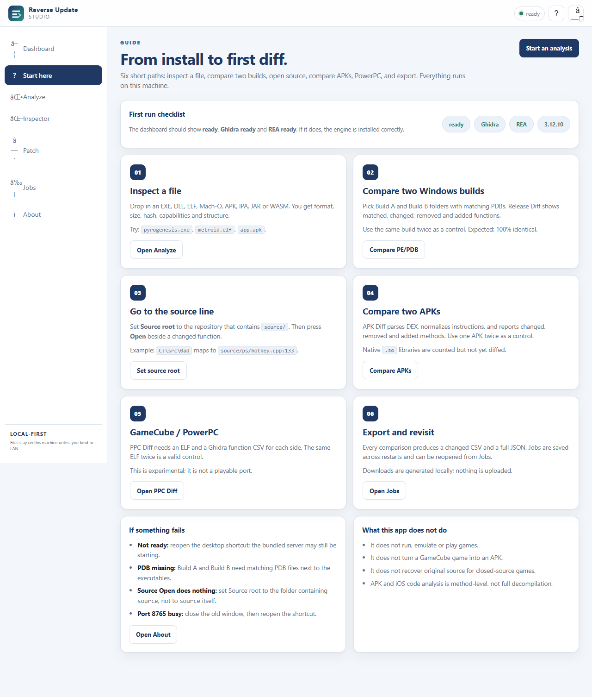

# Reverse Update Studio — Step-by-Step Manual

This is the full user manual. The short version is [TUTORIAL.md](TUTORIAL.md).



## 1. What you need

- Windows 10 or 11, x64
- About 2 GB free for the full package
- The portable ZIP from Releases
- Optional: a source checkout, Ghidra CSV, APKs, or game builds you are allowed to analyse

No administrator rights are needed for the normal install.

## 2. Install

1. Download:

```text
Reverse_Update_Studio_Windows_Portable_0.2.0.zip
```

2. Verify the SHA-256 from `Windows.sha256`.
3. Right-click the ZIP → **Extract All**.
4. Open the extracted `ReverseUpdateStudio` folder.
5. Double-click **Setup.cmd**.
6. Choose **Y** to start.

Setup installs to:

```text
%LOCALAPPDATA%\ReverseUpdateStudio
```

It creates:

- Desktop → **Reverse Update Studio**
- Desktop → **Uninstall Reverse Update Studio**
- Start Menu → **Reverse Update Studio**

If Windows says “Unknown publisher”, that is expected: the release is not
CA-signed yet. Verify the ZIP hash before choosing **More info → Run anyway**.

## 3. First launch

Double-click the Desktop shortcut.

Wait 5–10 seconds. The dashboard should show:

```text
ready
Ghidra ready
REA ready
Python 3.12
```

If it does not, see Troubleshooting.

## 4. The menu

| Menu | Use |
|---|---|
| Dashboard | status, recent jobs |
| Start here | six guided tasks |
| Analyze | inspect, PE/PDB diff, APK diff, PPC diff |
| Trace | path library, puzzle IDs, priority |
| Inspector | function address, calls, disassembly |
| Patch | apply/create patches |
| Jobs | history and downloads |
| About | limits, credits |

On a phone/tablet, the bottom bar has Home, Start, Analyze, Inspect, Patch, Jobs.
The **?** button opens Start here.

## 5. Inspect a file

1. Open **Analyze**.
2. Under **Inspect a file**, enter an absolute path, for example:

```text
C:\Windows\System32\notepad.exe
```

3. Click **Inspect**.

You get:

```text
Format
Size
SHA-256
Capabilities
Structure
```

Supported inspection:

- PE / EXE / DLL
- ELF
- Mach-O
- APK (classes/methods)
- IPA (container)
- JAR / class
- WebAssembly
- ZIP / archives

Inspection is not the same as function diff.

## 6. Compare two Windows builds

Use two folders containing EXE/DLL files and matching PDBs.

1. **Analyze → Compare two builds**
2. Build A:

```text
E:\builds\old\bin
```

3. Build B:

```text
E:\builds\new\bin
```

4. Labels: `0.27.0`, `0.27.1`
5. Click **Compare builds**.

Wait. The job runs in the background.

Result:

```text
matched
changed
removed
added
match rate
```

Then open **Changed functions**.

Use the same build twice as a control. Expected:

```text
changed = 0
removed = 0
added = 0
```

## 7. Go to the source line

1. In the compare form, set **Source root** to the repository root:

```text
C:\src\0ad
```

This folder must contain a `source` directory.
2. Run the comparison.
3. In **Changed functions**, click **Open** beside Source A or Source B.

Example:

```text
source/ps/hotkey.cpp:133
```

maps to:

```text
C:\src\0ad\source\ps\hotkey.cpp
line 133
```

VS Code is used when installed. Otherwise Explorer selects the file.

The path in the table is from the build machine. Only the part after
`\source\` is used.

## 8. Compare two APKs

1. **Analyze → Compare two APKs**
2. APK A: old APK
3. APK B: new APK
4. Click **Compare APKs**

Result:

```text
matched methods
identical methods
changed methods
removed
added
match rate
```

Use one APK twice as a control. Expected **100%**.

This compares DEX classes/methods with normalised instructions. It does not
decompile Java, compare resources, or diff native `.so` libraries yet.

## 9. GameCube / PowerPC

1. **Analyze → Compare two GameCube builds**
2. For each side, choose:
   - ELF
   - Ghidra function CSV
3. Click **Compare PPC builds**.

Use the same ELF twice as a control. Expected:

```text
matched = functions
changed = 0
```

This is experimental. It is not a playable port.

## 10. Trace a path

1. Open **Trace**.
2. Enter nodes, comma or newline separated:

```text
LoadConfig, ResolvePath, ParseXML, ApplyConfig, UnknownA, UnknownB
```

3. Click **Trace and score**.

Result:

```text
library matches
puzzle pieces
trace ID
priority + level
```

Unknown runs become puzzle pieces:

```text
pz_<hash>
```

The same unknown path gets the same ID and its occurrence count increases.
Use **Puzzle catalog** to review them.

## 11. Jobs and exports

Open **Jobs**.

Click a job to see its result.

Release Diff downloads:

```text
changed CSV
full JSON
```

APK Diff downloads:

```text
changed CSV
full JSON
```

Jobs persist across restarts in:

```text
%LOCALAPPDATA%\ReverseUpdateStudio\data
```

## 12. Updates

Do not apply demo packages to a real install.

Verify a demo package:

```powershell
cd "$env:LOCALAPPDATA\ReverseUpdateStudio"
.\runtime\python\python.exe .\update_cli.py verify `
  .\updates_demo\dist\update-0.2.1-*.rupkg `
  --public .\updates_demo\keys\signing-public.pem `
  --master .\updates_demo\keys\master.key
```

Apply to a **test folder**:

```powershell
.\runtime\python\python.exe .\update_cli.py apply `
  .\updates_demo\dist\update-0.2.1-*.rupkg `
  --target C:\temp\ru-test `
  --public .\updates_demo\keys\signing-public.pem `
  --master .\updates_demo\keys\master.key
```

Rollback:

```powershell
.\runtime\python\python.exe .\update_cli.py rollback --target C:\temp\ru-test
```

Production updates must use your own keys. See [UPDATE_SYSTEM.md](UPDATE_SYSTEM.md).

## 13. CLI

```text
reverse-update version
reverse-update doctor
reverse-update inspect file.apk
reverse-update diff --a A --b B --outdir out
reverse-update ppc-diff --elf-a A.elf --csv-a A.csv --elf-b B.elf --csv-b B.csv --outdir out
reverse-update apk-diff --a old.apk --b new.apk --outdir out
reverse-update path-trace --db traces.sqlite --nodes "A,B,C"
reverse-update update-verify --package x.rupkg --public pub.pem --master master.key
reverse-update update-apply --package x.rupkg --target install --public pub.pem --master master.key
reverse-update update-rollback --target install
```

On Windows, use `reverse-update.cmd`.

## 14. Troubleshooting

| Problem | Fix |
|---|---|
| Dashboard not ready | close the app, reopen the shortcut; wait 5–10 s |
| Port 8765 busy | close the old window; reopen |
| PDB missing | put matching PDB next to each EXE |
| Open does nothing | Source root must contain `source` |
| APK diff slow | large APKs take 1–3 minutes |
| Ghidra missing | install the full package or set Ghidra/JDK |
| Install fails | read `%LOCALAPPDATA%\ReverseUpdateStudio\data\logs\server.log` |
| Uninstall keeps files | close the app, run Uninstall again |

## 15. Uninstall

Start Menu → **Uninstall Reverse Update Studio**.

- **Y** — remove app, shortcuts and data.
- **K** — remove app and shortcuts, keep data in:

```text
%LOCALAPPDATA%\ReverseUpdateStudio-data
```

- **N** — cancel.

## 16. Safety and discretion

Use only files you own or are authorised to analyse.

Do not use this for:

- DRM or licence bypass;
- anti-cheat bypass;
- malware development;
- repackaging someone else’s app;
- publishing ROMs, ISOs, PDBs or proprietary binaries.

See [ETHICS.md](ETHICS.md).

## 17. Languages

The manual is English first. A translation template and glossary are in
[docs/manual/](docs/manual/). Do not machine-translate technical terms without
review.

## 18. Getting help

- Open an issue with the version, Windows version and exact error.
- Do not attach game ROMs, proprietary PDBs or personal data.
- Use the release matching your version.
