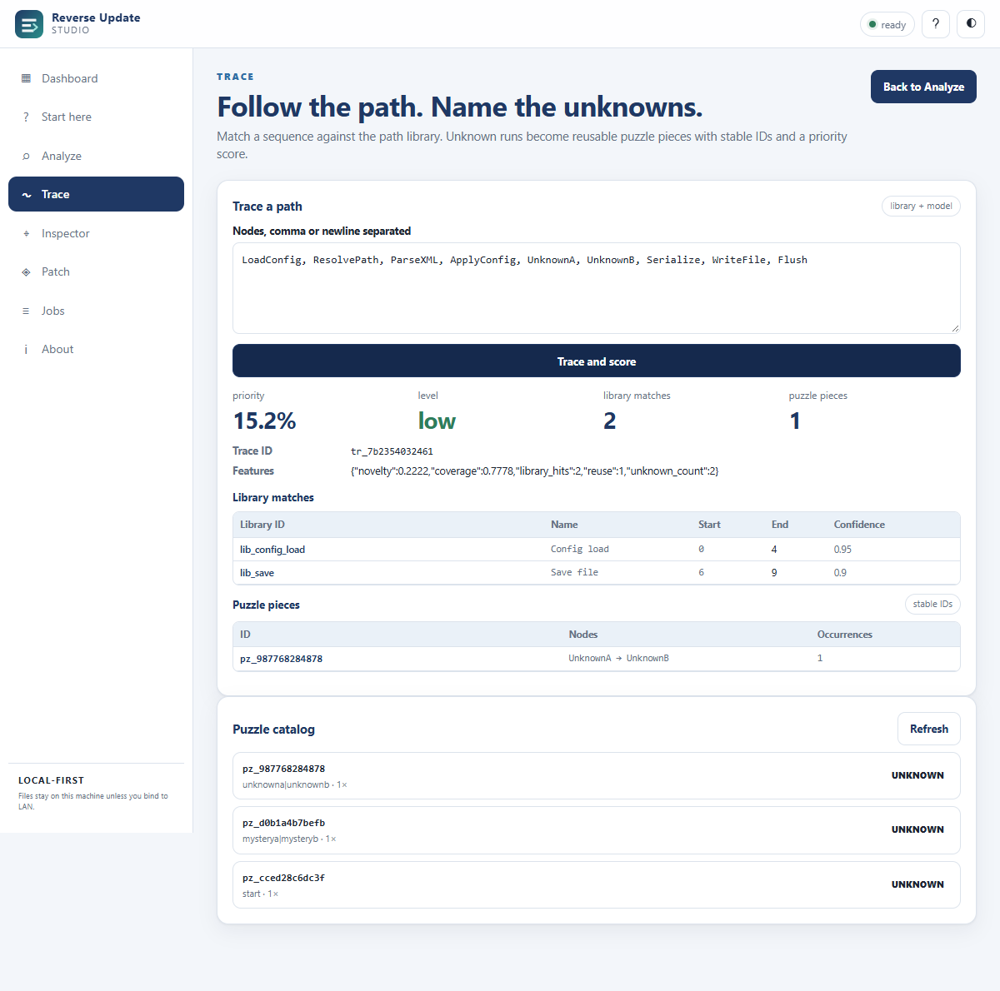

# Reverse Update Studio

[](https://github.com/Reddgen/reverse-update-studio/actions/workflows/ci.yml)
[](https://github.com/Reddgen/reverse-update-studio/actions/workflows/windows.yml)
[](LICENSE)
[](https://github.com/Reddgen/reverse-update-studio/releases)

Local-first release analysis for compiled software. Compare two builds, find
changed functions, map them to source lines, trace unknown paths, and verify
update packages.

It is a workbench, not a magic reverse-engineering button.



## Why this exists

A personal project by **Reddgen**, a regular tinkerer and music maker who kept
asking how an old build hands off to a new one.

Read [How this started](ORIGIN.md). Music: [yelledbox.com](https://yelledbox.com).

## What it does

| Feature | What it means |
|---|---|
| **PE/PDB Release Diff** | compare two Windows builds: matched, changed, removed, added functions |
| **Source mapping** | PDB file/line, plus optional Open in editor |
| **APK Diff** | compare DEX classes and methods with normalized instructions |
| **PPC Diff** | GameCube/PPC ELF plus Ghidra CSV comparison |
| **Inspect** | PE, ELF, Mach-O, APK, IPA, JAR, WASM, ZIP |
| **Trace** | match a path library; unknown runs get stable puzzle IDs and a priority score |
| **Updates** | AES-256-GCM payloads, Ed25519 manifests, chained apply and rollback |
| **Jobs** | background work, persistent history, CSV/JSON export |

It does **not** run games, emulate consoles, bypass DRM or anti-cheat, or turn a
game into a native app.

## Download

[Latest release](https://github.com/Reddgen/reverse-update-studio/releases/latest)

| Platform | File |
|---|---|
| Windows | `Reverse_Update_Studio_Windows_Portable_0.2.0.zip` |
| Linux | `Reverse_Update_Studio-x86_64.AppImage` |
| CI launcher | `ReverseUpdateStudio.exe` |
| Source | `Reverse_Update_Studio_Source_v0.2.0.zip` |
| Licenses | `RU-Licenses.zip` |

Verify with the accompanying `.sha256` files.

### Windows

1. Extract the ZIP.
2. Run `Setup.cmd`.
3. Choose `Y`.

Installs per-user to `%LOCALAPPDATA%\ReverseUpdateStudio` and creates Desktop and
Start Menu entries.

The release is **development-signed only**, so Windows may show an unknown
publisher warning. See [SIGNING.md](SIGNING.md).

## Quick start from source

```bash
pip install -r studio/requirements.txt
python cli.py doctor
python cli.py serve --port 8765 --open
```

Open <http://127.0.0.1:8765/>.

## What it is compared with

| Tool | Different because |
|---|---|
| `git diff` | source only; this works on compiled builds |
| Ghidra / IDA | deeper interactive RE; this is a narrow release workflow |
| BinDiff / Diaphora | more mature matching; this integrates source, APK, trace and updates |
| VirusTotal | reputation service; this shows code-level changes |
| `bsdiff` / `xdelta` | byte diff; this is function-level |
| `jadx` / `apktool` | decompiled Java/resources; this compares DEX methods |
| TUF | mature update security; this is a small local update engine |

Full comparison: [docs/DIFFERENCES.md](docs/DIFFERENCES.md).

## Status

- Windows: tested on Windows 10 and 11, including a clean non-admin PC.
- Linux: AppImage builds in CI; runtime testing is still needed.
- APK: method-level diff, not full decompilation.
- PPC: experimental.
- Signing: development self-signed only. CA/SignPath pending.
- Update system: demo payloads; production full-app updates pending.

See [RELEASE_STATUS.md](RELEASE_STATUS.md).

## Documentation

- [Full step-by-step manual](MANUAL.md)
- [Manual translations](docs/manual/README.md)
- [Tutorial](TUTORIAL.md)
- [CLI](CLI.md)
- [Format support](FORMAT_SUPPORT.md)
- [Update system](UPDATE_SYSTEM.md)
- [Path tracing](PATH_TRACE.md)
- [Plain-language concepts](docs/CONCEPTS.md)
- [How this is different](docs/DIFFERENCES.md)
- [Signing](SIGNING.md)
- [SignPath notes](SIGNPATH.md)
- [Acknowledgements](ACKNOWLEDGEMENTS.md)
- [Acceptable use and ethics](ETHICS.md)\n- [Roadmap](ROADMAP.md)\n- [Contributing](CONTRIBUTING.md)\n- [Support](SUPPORT.md)

## Development

```bash
python -m unittest discover -s tests -p "test_*.py" -v
```

CI runs on Windows and Ubuntu for every push.

Good first issues are labeled `good first issue`. Feedback can be submitted with
the **Feedback** issue form.

## Feedback

Use the **Feedback** issue form:

https://github.com/Reddgen/reverse-update-studio/issues/new?template=feedback.yml

Tell us:

- what you tried;
- what worked;
- what was confusing;
- which OS and version.

Do not attach game files, proprietary PDBs, ROMs or personal data.
## Credits

Built with Ghidra, LIEF, androguard, Capstone, pefile, RomPatcher.js, REA,
Python, Node.js and Temurin. Full license texts are in
[LICENSES/](LICENSES/); notices are in
[THIRD_PARTY_NOTICES.md](THIRD_PARTY_NOTICES.md).

## Support

Optional: <https://buymeacoffee.com/yelledbox>

Donations do not buy priority support or change the MIT license.

## License

MIT for original code. See [LICENSE](LICENSE) and
[THIRD_PARTY_NOTICES.md](THIRD_PARTY_NOTICES.md).

No game ROMs, ISOs, PDBs or proprietary binaries are included.


